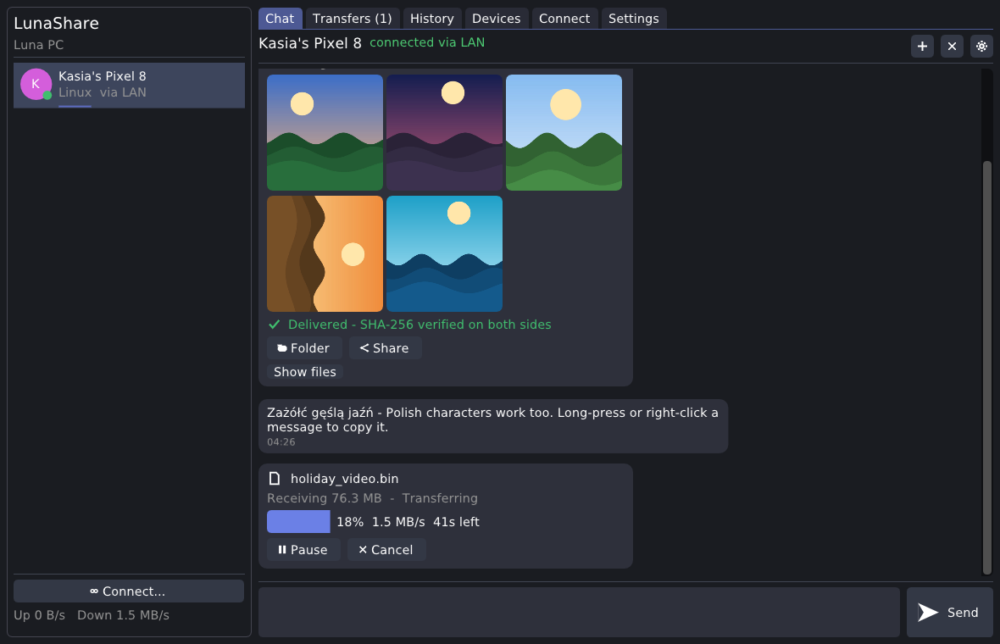
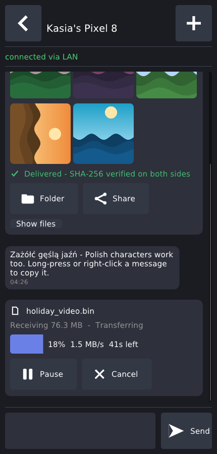
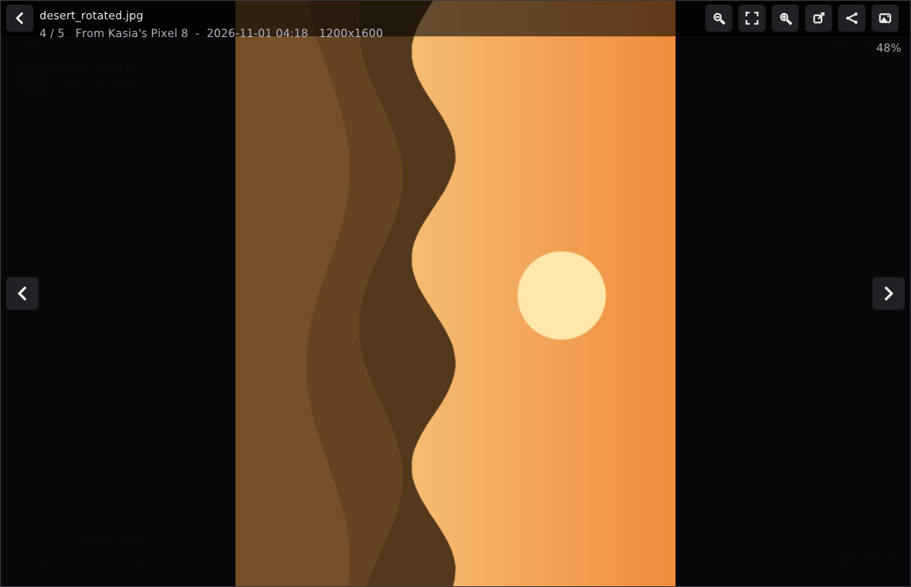
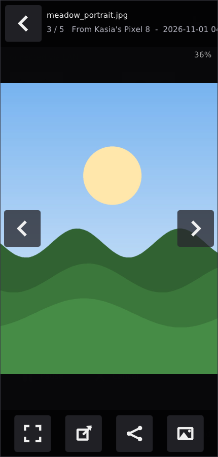
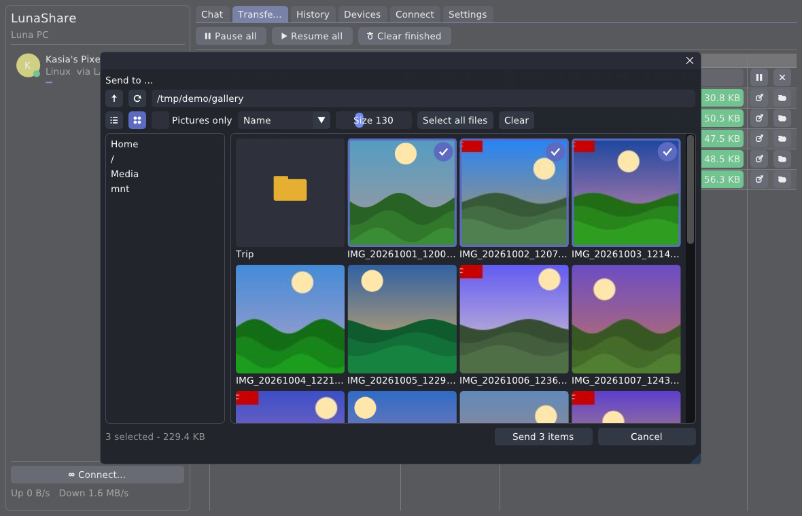
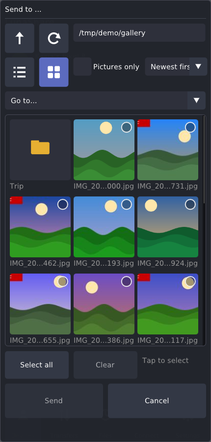
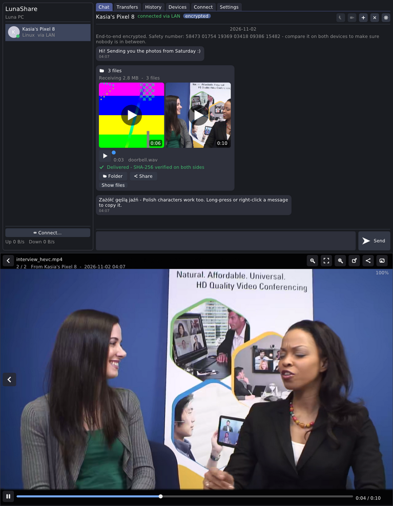
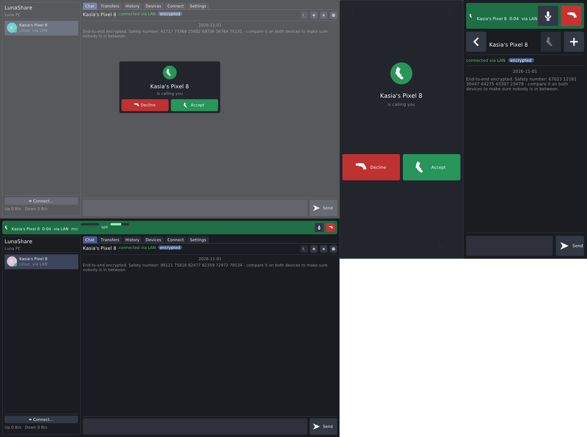
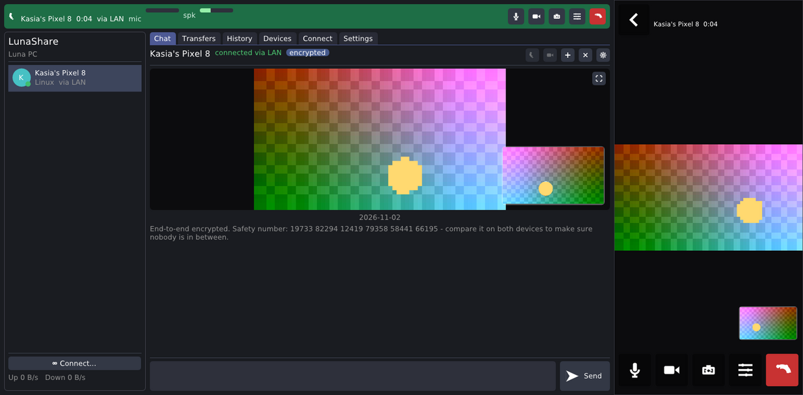
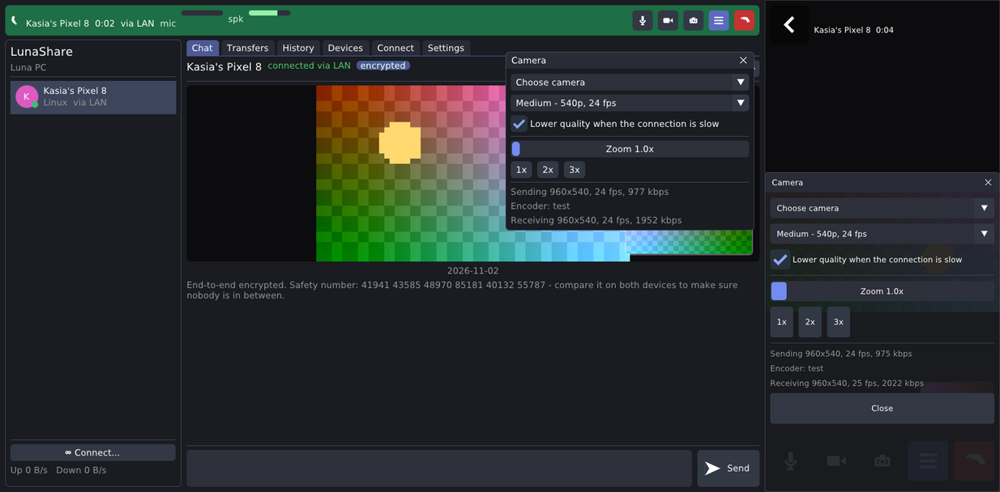

# LunaShare

A chat app built around file sharing, with voice and video calls, groups and watching movies together. It is written in
C++ with [Dear ImGui](https://github.com/ocornut/imgui) on SDL2 and runs on **Android**, **Windows** and **Linux**.
Devices on the same network find each other automatically; over the internet they meet through a small server you run
yourself. Transfers can be paused and resumed at any time, and every file is SHA-256 hashed before sending and again
after receiving, so you know it arrived intact.

**Download:** [Releases](https://github.com/LunaMoo/LunaShare/releases) - the Android APK, a Windows and a Linux zip
(the app with its optional `modules/` folder and the rendezvous server) and the OPNsense plugin.

| Desktop | Phone |
|---|---|
|  |  |
|  |  |
|  |  |

## Features

**Sharing**
- Drag and drop files or whole folders onto the window. Folder structure is kept.
- Pause and resume from either side, at any time. Transfers also survive disconnects and app restarts:
  the receiver keeps a `.part` file and both sides continue from where they stopped.
- Integrity checks: the sender computes the SHA-256 before offering, every chunk carries a CRC-32, and the receiver computes the SHA-256 of the finished file. The chat card shows *"SHA-256 verified on both sides"*. If the hashes don't match, the partial file is discarded and you can **Retry**.
- Several files stream in parallel (configurable). There's an optional upload speed limit and a free-space check before accepting.
- Before sending, the app checks that the source file hasn't changed (size + mtime) since it was hashed.

**People, accounts and profile pictures** (see [docs/ACCOUNTS.md](docs/ACCOUNTS.md))
- Your **account** is a key that belongs to you; no sign-up, no server account. Link your phone and computer to it
  (*Settings → Your account → Link another device…*, both screens show the same 6-digit code): messages to you reach all
  your devices, what you write on one appears on the others, and your contacts see one person instead of several devices.
- A **profile picture** (crop it in a round preview) is shared with, and cached by, everyone you connect to.
- Keep your account safe with the **24-word recovery phrase** or a password-protected **backup file**.
- With an internet server: **offline messages** wait on it (sealed, the server can't read them), messages show
  *delivered* / *read*, you can claim a **username** so others can find you, and phones stay connected in the
  **background** with notifications and a ringing call screen.

**Groups** (see [docs/GROUPS.md](docs/GROUPS.md))
- **Group chats**: a name and the people; messages reach everyone, also people who have never met each other.
- **Group voice and video calls**: everyone hears everyone; in video calls you watch one person at a time (the one
  with the camera on who talks, or whoever you tap). Directly between the devices, or **through your server**, where
  every phone uploads its voice and video only once (and group members you don't know never connect to you).

**Watch together** (see [docs/WATCH.md](docs/WATCH.md))
- Stream a movie from your device to a person or a group and watch it in sync: pausing or jumping affects everyone,
  and everyone waits for whoever is still loading. Original quality, nothing to send in advance.
- **Movie player:** play a movie alone and add people (or a group) later; videos in contacts' Shared folders play
  while they stream. Loop for everyone, and viewers can save a copy.
- Pick the sound track and subtitles (from the movie, from files next to it, or any file you choose); the host's
  subtitles are offered to everyone. Full screen with controls that hide by themselves; phones turn to landscape.

**Chats** (see [docs/CHAT.md](docs/CHAT.md))
- Links open in the browser. Chat history: archive (compressed) and clear, restore, or ask the other side to send it
  back if you lost it.

**Music player** (see [docs/MUSIC.md](docs/MUSIC.md))
- Your music folders and everything you receive, with tags and covers; songs, artists, albums, genres, folders and
  your own playlists; repeat, shuffle, a mini player everywhere.
- Plays on in the background (Android: media notification, lock screen, headset buttons; Windows: media keys) and
  pauses for movies and calls. Send songs or whole albums (as a folder) to people.

**Opening files with LunaShare**
- **Android:** LunaShare is in the system's *Open with* for pictures, movies, songs, archives and comics, and in
  *Share* for any file (or text): pick a chat and it's sent.
- **Windows / Linux:** *Settings → Opening files* adds LunaShare to the file manager's *Open with* (for you only, no
  administrator; Windows also lists it in *Default apps*, where it can become the default). `LunaShare <files>` opens
  them too; `--send` shares them to a chat instead.
- One copy per settings folder: starting LunaShare again (or opening a file with it) brings up the running one and
  shows the file there.
- Equalizer, smooth transitions and a remix mode (a part of every song, blending into the next).
- Listening together: everyone adds songs from their own music to a shared queue; each streams from its device.
  Songs in contacts' Shared folders play straight in the music player.

**Library (Shared folders)** (see [docs/LIBRARY.md](docs/LIBRARY.md))
- Files in your *Shared* folder can be browsed and downloaded by your contacts. A download comes from every contact
  that has the file at once (piece by piece, each piece verified), and you then share it on.

**Chat**
- Text chat per person. Messages queue while the other side is offline and show delivered/queued state.
- Selecting and copying: click to select, Ctrl/Shift+click for several, Ctrl+C copies them (with timestamps when several are selected). Double-click or *Select text…* opens a view where you can select part of a message. On phones, long-press enters selection mode.
- Pictures appear as thumbnails in the chat (EXIF rotation is respected). Tapping one opens a **full-screen viewer**:
  swipe left/right (or arrow keys and the side buttons) to go to the previous/next picture, pinch, mouse wheel or +/- to zoom,
  double-tap to zoom in, drag to pan. Toggle between *this chat's pictures* and *all shared pictures*.
- Incoming offers appear in the chat and as notifications with Accept/Decline. Trusted devices are accepted automatically.

**Picking files**
- The built-in file picker works the same on desktop and phones. You can switch between a **list** and a **gallery of thumbnails**,
  with a *Pictures only* filter, sorting by name / newest / largest, and adjustable tile size.
- Gallery tiles load fast because they use the small preview that cameras embed in every JPEG (EXIF), with the photo's
  rotation applied. Images without one are decoded in the background, and what's on screen loads first.
- Tap tiles to select several (Ctrl/Shift-click on desktop), *Select all*, see the selected count and total size.
  Long-press (right-click on desktop) a picture to preview it large; long-press a folder to send the whole folder.
  Quick shortcuts on Android: Camera, Pictures, Screenshots, Download.

**History & re-sharing**
- Every sent and received file goes into a searchable history (name, device, hash). Select any number of entries and
  **share them with another device** in one click. You can also do this from a chat card or the picture viewer.

**Devices**
- Every device has a permanent random ID (UUID). User name, host name, platform and MAC addresses are stored as extra information.
  MACs can't be the primary key because phones randomise or hide them. If a known MAC shows up with a new ID (app reinstalled),
  the nickname is carried over.
- A list of every device you've ever connected to, with **custom nicknames**, a trusted flag (auto-accept), blocked, notes, last address, and Bluetooth address.

**Connectivity**
- **LAN, no setup:** two discovery methods running side by side, then a TCP connection (port 47820, falls back to the next free one):
  - **Bonjour / mDNS** (`_lunashare._tcp`, RFC 6762/6763), with a built-in responder/browser that shares port 5353 with
    the OS (the system Bonjour API on Apple systems). Works on most routers.
  - **UDP broadcast + multicast beacons** (port 47821). Fast, and works on networks that filter mDNS.

  Both can be switched on or off in Settings. Known devices are reconnected automatically when they still have work pending.
- **Phone-to-phone with no Wi-Fi:** one phone starts a hotspot (Android LocalOnlyHotspot) and shows a Wi-Fi QR code the other phone can scan
  with its camera. If the two are already connected over Bluetooth, one tap sends the hotspot login across and the other phone
  joins automatically. The app then switches to full Wi-Fi speed.
- **Bluetooth RFCOMM:** Windows (Winsock + SDP), Linux (BlueZ, fixed channel), Android (Java bridge). Good for chat, small files, and handing over hotspot logins.
- Manual connect by `ip[:port]`.
- **Over the internet (optional):** run the small **rendezvous server**. There's a ready-made **OPNsense plugin**, or it runs on
  any Linux or Windows machine. Devices with the same room name and password find each other through it and then connect
  **directly peer-to-peer** (UDP hole punching + KCP, helped by UPnP / NAT-PMP port mappings). When no direct path
  exists (a router you can't configure, carrier-grade NAT on both sides), the server relays the still end-to-end
  encrypted packets. Only the server address needs to be set; everything else is under *Settings → Advanced*.
- **Invites (private contacts):** instead of sharing your room, invite people with a code (*Settings → Invites*, or click
  your own name above the device list; on phones the button on the main screen). Each of them reaches only you - or
  the others in the same *invite room* - and never learns about the rest. They don't see the server's address, and
  the server remembers them (even after a reinstall) until its admin releases them.
  See [docs/INTERNET.md](docs/INTERNET.md).

**Languages**
- English and Polish. *Settings → Appearance → Language* switches right away; *automatic* follows the system language.
- Adding a language: copy `src/app/lang/pl.inc` to `<code>.inc`, translate the second string of every line (keep
  `%s`/`%d` in the same order), and add it to the two lists in `src/app/i18n.cpp`. `tools/i18n_keys.py src/app/lang/<code>.inc`
  shows strings that are missing or no longer used.

**Security**
- Every connection is end-to-end encrypted: an X25519 key exchange per connection (forward secrecy),
  XChaCha20-Poly1305 for every frame, and a per-device EdDSA identity key ([Monocypher](https://monocypher.org)).
- The identity key signs the key exchange, so a man in the middle can't relay it. Keys are pinned to the device on first contact. If a known device later shows up
  with a different key, the connection is refused and you have to review it (*Accept new key* or *Block*).
- Each pair of people has a **safety number** (30 digits from the two account keys, identical on both screens). Compare it once and mark them as *verified* - or let each phone **scan the other's QR code**, which checks the keys for you; their other devices are vouched for by their account.
- Bluetooth links and hotspot logins sent over them are encrypted the same way. Only the discovery beacons (name, ID, port) are plain.

**Audio and video files (optional player module)**
- Videos you send or receive show a thumbnail with their length. Tapping one plays it in the full-screen viewer, where you can swipe
  between pictures and videos and use play/pause and a seek bar. Audio files (mp3, m4a/aac, ogg/opus, flac, wav) play right in the chat bubble.
- Containers: mp4/mov, mkv/webm, ogg, avi, mpeg-ts, mp3, flac, wav. Video: H.264, HEVC, AV1, VP9, VP8, MPEG-4, MPEG-2, VC-1.
  Sound: AAC, MP3, Opus, Vorbis, FLAC, ALAC, PCM, and the movie formats AC-3, E-AC-3, DTS and TrueHD; 5.1 and 7.1 are
  mixed down to stereo with the dialogue kept. Several sound tracks and subtitles (SRT, ASS, WebVTT, MP4 text, and the
  picture subtitles of Blu-ray / DVD rips) can be chosen. Phone videos are shown upright using their rotation tag.
- **Windows:** `lunashare_player.dll` plus a trimmed FFmpeg in `modules/`; video is decoded on the graphics card where possible.
- **Android:** the phone's hardware decoders for video, and a small built-in FFmpeg for sound tracks and subtitles.
- **Linux:** `liblunashare_player.so` with the same FFmpeg as the Linux video module, in `modules/`.



**Emoji (optional emoji module)**
- Colour emoji in messages, drawn with the system's own emoji font, so they look like everywhere else on that device:
  Segoe UI Emoji through DirectWrite on Windows, the phone's emoji font on Android, and Noto Color Emoji (or any colour
  emoji font) through FreeType on Linux. Sequences work: skin tones, families and other ZWJ emoji, flags, keycaps.
- The smiley button left of the text box opens a picker with categories, search, recently used emoji and a skin tone
  choice. Emoji typed or pasted from the phone keyboard turn into pictures right away.
- A message of only one to three emoji is shown big.
- **Reactions:** hover a message and click the smiley next to it (on phones: long-press it, or right-click on desktop)
  for 👍 ❤️ 😂 😮 😢 🙏 or **+** for any emoji. Each side has one reaction per message; picking it again or clicking your
  pill under the bubble removes it, and clicking the other person's pill reacts the same. Reactions reach a device that
  is offline once it is back, and you get a notification when someone reacts while you're in another chat.
- The module (`lunashare_emoji`) is tiny, because it ships no font. Without it, emoji show as plain characters.
- On Android, characters none of the app's fonts has (Japanese track names, for example) are drawn with the phone's own
  fonts.

**Voice messages (needs the voice module)**
- With nothing typed, the Send button becomes **Voice**. Tap it to record: the bar shows a timer and a level meter, with
  **Discard** and **Send**. Recordings are Opus in Ogg (about 3 KB per second, noise-suppressed and levelled), up to 10 minutes,
  and play in the chat like any other audio file. Anything under half a second is thrown away. A call ends a recording that is in progress.

**Video messages (needs the voice and video modules)**
- The camera button next to **Voice** opens a camera preview filling the chat (front camera on phones; switch cameras before
  you start). **Record** starts, **Send** stops and sends. Messages are MP4 files (H.264 with Opus sound, up to 3 minutes) in
  the resolution and frame rate set for video calls (720p30 is about 16 MB a minute) that play in the chat with the player. The picture keeps the phone's orientation from the moment
  recording starts, like a camera app.

**Voice calls (optional module)**
- Calls live in a separate plug-in, `lunashare_media` (`lunashare_media.dll` / `liblunashare_media.so`), which is loaded at
  startup only if it's present. Without it LunaShare is the plain chat + file app, and the call button doesn't appear. Delete the file to remove calls.
- One-to-one and group calls (see **Groups** above).
- The call button sits in the chat header. It's only shown when **both** devices have the module, since each device announces its capabilities.
- Calls go peer-to-peer over the same encrypted connection as chat (LAN, hotspot, internet/KCP, and in principle Bluetooth, though there it can be choppy).
- Audio: Opus (48 kHz fullband, 16–128 kbit/s, default 48, in-band FEC), an adaptive jitter buffer with loss concealment, SpeexDSP for echo cancellation and auto gain, and RNNoise for noise suppression.
- During a call, file transfers to that device are throttled so they don't cause audio stutter.
- Call bar: timer, mic/speaker levels, link stats (loss, jitter, delay), and buttons for mute, speaker (phones) and hang up. Incoming calls get a ringtone and a full-screen answer screen on phones.
- Calls are logged in the chat (*Outgoing call – 2:31*, *Missed call*, …).
- *Settings → Calls*: choose input and output devices, turn echo cancellation, noise suppression and auto gain on or off, set quality, and run a microphone test.
- Android ships as one APK with everything (`org.lunamoo.lunashare`). Microphone and camera are asked for only the first
  time you call or record; build with `-DLUNASHARE_BUILD_VOICE=OFF -DLUNASHARE_BUILD_VIDEO=OFF` for a version without them.
- Every module has a small, versioned C ABI in `src/media_api/`.



**Video calls (optional module: Windows, Linux and Android)**
- A second plug-in, `lunashare_video` (`lunashare_video.dll` / `liblunashare_video.so`), sits next to the voice module. It adds the
  video call button when both devices have it, and any call between two video-capable devices can turn the camera on or off.
- **Sharing the screen** (Windows and Linux): *Screen (share it)* is one more choice in the call's camera list - the whole
  desktop, ten pictures a second (at most 1920 wide), through the same encoder. Linux grabs it through X11 (on Wayland only
  what XWayland shows). Not on Android yet.
- Windows and Android use the system's own H.264: Media Foundation on Windows (a GPU encoder when one works, otherwise
  Microsoft's software encoder) and MediaCodec on Android (hardware).
- **Linux:** cameras through V4L2 (raw YUYV/NV12 or MJPEG, whichever gives the asked size and frame rate). H.264 is encoded on
  the graphics card when it can - NVIDIA NVENC, or VA-API on Intel / AMD (the system's VA-API driver, e.g. `intel-media-driver`
  or Mesa's `va` driver) - and with x264 on the CPU otherwise; decoding (H.264 / HEVC / AV1) likewise tries VA-API / NVDEC
  first, then the CPU (dav1d for AV1). The camera panel shows which encoder and decoder are in use. Everything comes from the
  FFmpeg bundled in `modules/` (with libva); `LUNASHARE_NO_GPU_ENCODE=1` forces x264.
  Zoom, exposure, focus, white balance and brightness are offered when the webcam has them.
  **LunaShare Camera** for other apps (browsers, Zoom, OBS...) uses the v4l2loopback kernel module (package `v4l2loopback-dkms`);
  LunaShare loads it with `pkexec` the first time it's switched on after a reboot, so phones can be used as webcams on Linux too.
  Your user needs access to `/dev/video*` (the `video` group on most distributions).
- **Android battery use:** the camera feeds the hardware encoder directly, so frames never pass through the CPU. The self-view is a
  small 15 fps stream, and the camera runs at a fixed frame rate.
- **Quality:** choose the resolution (360p, 540p, 720p, 1080p, 1440p or 4K) and frame rate (15, 24, 30, 60 or 120 fps) in *Settings → Calls*
  or during a call. The bitrate follows from both: about 5 Mbit/s for 1080p at 30 fps, and about 60 Mbit/s for 4K at 120 fps, which needs fast Wi-Fi.
  If a camera or encoder can't do a combination, the closest one it can do is sent, and the call stats show the actual numbers.
  On Android, 120 fps uses the camera's high-speed mode, which has no self-view stream; the other side still gets the full rate.
  Colour conversion, rotation and mirroring run on the GPU. On Windows, received video is decoded by the graphics card.
  8K is offered as well; a receiving device that can't decode a size asks the sender for a smaller one.
  With *Lower quality when the connection is slow* on (the default), smoothness comes first: the bitrate follows what
  the link actually carries, and if it stays too slow the camera steps down (fewer frames first, then smaller sizes)
  and back up once the link keeps up.
  Voice always goes ahead of video.
- **Camera panel (during a call):**
  - Phones: zoom (including the ultra-wide lens, e.g. 0.6x, where the phone has one), switching between cameras, exposure
    compensation, manual ISO and shutter, auto or manual focus, flashlight, white balance and stabilization. What's available
    depends on the camera.
  - Webcams: zoom, focus, exposure and brightness, when the camera supports them.
- **Codecs:** H.264 always works. Devices also announce whether they can do HEVC and AV1, and the sender picks the best codec both sides support
  (AV1, then HEVC, then H.264). Phones only offer codecs they encode and decode in hardware. On Windows, HEVC and AV1 are decoded with a
  trimmed FFmpeg (`avcodec-61.dll` and `avutil-59.dll` in `modules/`, LGPL). It uses the graphics card's decoder through D3D11VA
  when there is one, so the paid Microsoft HEVC extension isn't needed. Without a GPU decoder, HEVC is decoded on the CPU, and AV1 is
  only offered when the GPU can decode it. *Use only H.264* in *Settings → Calls* turns this off if something misbehaves.
- **Picture orientation:** phones read their position from the motion sensor, so the picture is upright even with auto-rotate off.
  You can also turn the received picture left or right with the buttons in the corner of the video, and that also applies to the virtual camera.
- **Lost or late video** isn't buffered for long. The receiver asks for a fresh keyframe, so the picture recovers within a moment.
- **Virtual camera (Windows 11):** turn on *Settings → Calls → Virtual camera* and the PC gets a webcam called **LunaShare Camera**.
  Teams, Zoom, OBS, Discord and other apps can pick it. It shows the video received in a call, for example your phone's
  camera, and a dark picture otherwise. Windows asks for administrator permission once, to install the small camera
  component (`lunashare_vcam.dll`) into `%ProgramData%\LunaShare`, where the Windows camera service can load it.
  It offers 360p up to 4K, at 30 or 60 fps.
  The **webcam button** in the chat header starts a camera-only session without a full call:
  - On the PC (with the virtual camera on), it asks the other device for its camera. The phone has to allow it.
  - On a phone chatting with a Windows PC, it offers the phone's camera to that PC.
  - Microphones start muted on both sides, and LunaShare Camera shows the picture.
- On phones a video call opens full screen with the call buttons at the bottom. On desktop the video sits above the chat and can be enlarged.




**Settings**
- The top of the settings has what most people need: invites, profile, account, the server, the download folder and the
  look. Everything technical (discovery, ports, speed limit, chunk size, parallel files, Bluetooth, rooms...) is under *Advanced*.
- **Windows:** can keep running in the tray when the window is closed. **Android:** can keep running in the background
  (with notifications and a ringing call screen).
- Layout: *automatic*, *desktop*, or *phone*. Phones get a vertical UI with large buttons, a bottom navigation bar, drag-to-scroll with inertia, and long-press menus.
  A narrow, tall desktop window switches to the phone layout automatically.
- **Export/import** settings to a JSON file. The export includes known devices and their custom names. Chat and file history are optional, and so is the device identity (only for restoring the same device).

## Building

Requirements: CMake 3.16+, a C++17 compiler. Dependencies are fetched automatically (SDL2 2.32, Dear ImGui 1.93, nlohmann/json, qrcodegen, quirc, stb_image, Monocypher, KCP).

```sh
cmake -S . -B build -DCMAKE_BUILD_TYPE=Release
cmake --build build --config Release
./build/lunashare_tests        # headless end-to-end tests (two engines over loopback)
```

- **Windows:** Visual Studio 2022 or MinGW/llvm-mingw. The result is a single `LunaShare.exe`.
- **Linux:** needs X11/Wayland and GL development packages for SDL (see `.github/workflows/build.yml`).
- **macOS:** builds `LunaShare.app` (chat and files; not maintained and not built by CI).
- **Android:** open `android/` in Android Studio, or run `gradle assembleRelease` in `android/`. The Gradle build fetches SDL's Java glue
  and builds the native code through the same top-level `CMakeLists.txt`. Needs NDK 27; Android 7 (API 24) or newer.
  The sound/subtitle FFmpeg for the player is built per ABI into `ffandroid/` (see the workflow); without it the player
  plays video and the usual sound formats only.
  On Android 11+ the app asks for *All files access* so it can send any file and save to `Download/LunaShare`.
- Options: `-DLUNASHARE_GL_API=GL3|GLES2|GLES3`, `-DLUNASHARE_SYSTEM_SDL=ON`, `-DLUNASHARE_BUILD_APP=OFF` (engine + tests only),
  `-DLUNASHARE_BUILD_VOICE=OFF` (skip the voice module, along with Opus, SpeexDSP and RNNoise), `-DLUNASHARE_BUILD_VIDEO=OFF` (skip the video module),
  `-DLUNASHARE_VIDEO_TEST_MODULE=ON` (development: a video module with a test-pattern camera on systems without a real backend).
- The modules (voice, video, player, emoji) build next to the executable. To ship them, put them next to `LunaShare.exe`
  or in a `modules/` folder, together with the FFmpeg libraries for the player and video modules. `./build/lunashare_voice_tests` checks the audio pipeline
  (packet loss, jitter, echo cancellation), and `./build/lunashare_video_tests` checks the video core (keyframe recovery after loss, bitrate adaptation on a slow link).
- Offline builds: pass `-DFETCHCONTENT_SOURCE_DIR_<NAME>=/path` for `IMGUI`, `SDL2`, `NLOHMANN_JSON`, `QRCODEGEN`, `STB`, `MONOCYPHER`, `KCP`, `OPUS`, `SPEEXDSP`, `RNNOISE`, `QUIRC`.

The GitHub Actions workflow builds Windows, Linux, the Android APK and the OPNsense plugin (FreeBSD) on every push and
uploads them as artifacts.
Every push to `main` updates the *latest* pre-release. When a new version (the `VERSION` in `CMakeLists.txt`) first reaches
`main`, a release `vX.Y.Z` is published with that version's notes from [CHANGELOG.md](CHANGELOG.md).

Command line: `--portable` (keeps settings in `LunaShareData` next to the executable), `--config <dir>`.

## Layout

```
src/core/        engine (no UI dependencies)
  engine.*         connections, discovery, chat, resumable transfers, persistence
  groups.cpp       group chats          group_calls.cpp  group voice/video calls (direct or through the server)
  watch.cpp        watch together       library.cpp      shared folders, multi-source downloads
  listen.cpp       listening together (shared music queue, songs streamed from each device)
  chat_archive.cpp chat archives, history sent back
  protocol.*       framing: [u32 len][u8 type][payload]  (JSON control frames, binary data frames)
  crypto.*         handshake, frame encryption, identity and account keys, safety numbers
  hash.*           SHA-256, CRC-32
  mdns.*           Bonjour/mDNS service discovery
  wan.*            internet transport: rendezvous client, hole punching, NAT-PMP, relay, KCP sessions, invites
  upnp.*           UPnP IGD port mapping
  rendezvous_server.*  the rendezvous server (also used by the tests)
  bluetooth.*      RFCOMM per platform + HostBridge hooks for Android
  model.*          settings / devices / messages / transfers / history + JSON
  platform.*       paths, MACs, interfaces, UTF-8 file I/O
src/app/         SDL2 + Dear ImGui front end
  ui.cpp           desktop & phone layouts, chat, transfers, history, devices, connect, settings, invites
  ui_groups.cpp, ui_watch.cpp, ui_library.cpp, ui_account.cpp, ui_viewer.cpp (pictures + full-screen viewer)
  media_host.*, player_host.*, emoji_host.*   load the optional modules
  image_cache.*    async image decoding, EXIF orientation, GL texture cache
  file_browser.*   built-in file picker (works the same on phones)
  i18n.cpp, lang/  translations
  android_bridge.cpp  JNI glue to android/.../LunaShareActivity.java
src/media_api/   the C ABIs between the app and the modules
modules/voice/   voice (lunashare_media): Opus + SpeexDSP + RNNoise + jitter buffer + mixing
modules/video/   video (lunashare_video): Media Foundation (Windows), V4L2 + FFmpeg (Linux), Camera2 + MediaCodec (Android)
modules/vcam/    Windows 11 virtual camera (lunashare_vcam.dll, loaded by the camera Frame Server)
modules/player/  player (lunashare_player): FFmpeg (Windows/Linux), MediaCodec + FFmpeg (Android); subtitles
modules/emoji/   colour emoji from the system's emoji font
server/          lunashare-rendezvous daemon + systemd unit
opnsense/        OPNsense plugin (Services > LunaShare rendezvous) + install.sh
android/         Gradle project
tests/           engine, voice, video and player tests
```

## Protocol notes

0. Key exchange (see `src/core/crypto.h`). Everything below is sent encrypted.
1. Both sides send `Hello` (id, name, user, host, platform, MACs, identity public key, and a signature over the handshake). If two devices connect to each other at the same time, the duplicate connection is dropped deterministically.
2. The sender hashes the file, then sends `FileOffer` (tid, relative path, size, sha256, batch).
3. The receiver replies `FileAccept {offset}`, where offset is the size of its `.part` file. The same message is used to resume.
4. `FileData` frames: `[tid][offset][crc32][bytes]`. If an offset or CRC is wrong, the receiver sends a new `FileAccept` from the last good offset.
5. `FileDone` → the receiver hashes the file → `FileVerify {ok, sha256}`. The file is renamed into place only after the hash matches.
6. `FilePause` can come from either side. Resuming is done with an offer carrying `resume:true`, or with an accept carrying `resume:true`.
   After a reconnect, the sender re-offers everything that isn't finished, and the receiver answers based on its own state.

## Status / known limitations

- **Android** and **Windows** are what LunaShare is mostly used and tested on: chat, files, calls, groups, watching
  together and the internet server with invites. **Linux** builds and passes the same automated tests, but has seen
  less use on real hardware; the webcam (V4L2) and virtual camera (v4l2loopback) code hasn't met many real cameras yet.
- **macOS** compiles from source with chat and files only (no calls, player or Bluetooth) and isn't built by CI.
  There is no iOS version.
- Linux Bluetooth uses a fixed RFCOMM channel (no SDP record), so Windows/Android→Linux connections need the same channel.
- The identity secret is stored in `settings.json` in the user's config folder, with the same protection as an SSH key. A settings export only includes it
  when you choose *include identity*.
- The rendezvous server and the app should be updated together; an older server lacks newer features (invites,
  group calls through the server), and the app says so in the settings.

## License

LunaShare is licensed under the [GNU General Public License v3.0](LICENSE).
Third-party components keep their own licenses: Dear ImGui (MIT), SDL2 (zlib), nlohmann/json (MIT),
QR Code generator (MIT), quirc (ISC), stb_image (MIT / public domain), Monocypher (BSD-2-Clause / CC0), KCP (MIT),
and in the voice module Opus (BSD-3-Clause), SpeexDSP (BSD-3-Clause) and RNNoise (BSD-3-Clause).

FFmpeg: the Windows and Android builds use LGPL builds; on Linux the bundled FFmpeg includes x264 and is therefore
GPL-2.0-or-later (compatible with LunaShare's GPL-3.0); dav1d is BSD-2-Clause, libva is MIT. Their license files are
in `modules/`.
